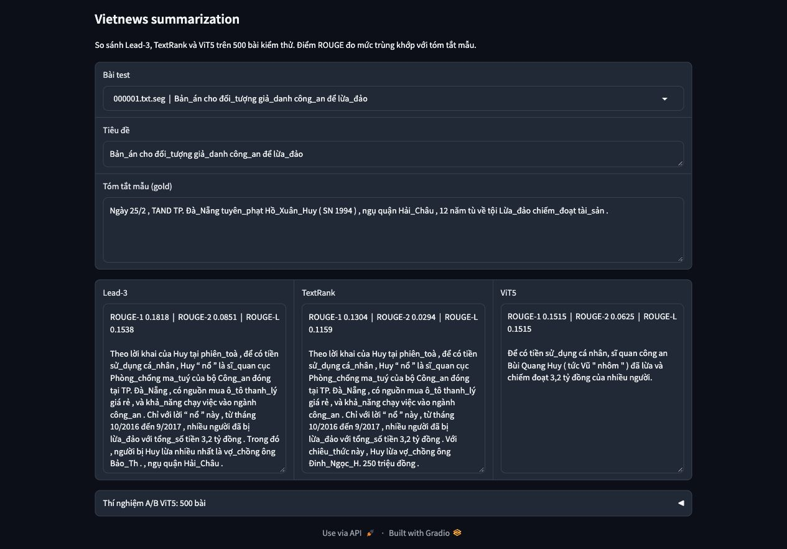

# Vietnews summarization

So sánh tóm tắt rút trích (Lead-n, TextRank) và tóm lược bằng checkpoint ViT5 trên tin tức tiếng Việt. Đồ án môn **CS221.F31.LT.TTNT – Xử lý ngôn ngữ tự nhiên**, UIT, giảng viên **TS. Đặng Văn Thìn**. Nhóm 14: Nguyễn Trí Toàn, Nguyễn Văn Thái, Đỗ Quốc Hoàng.



Dữ liệu: [Vietnews](https://github.com/ThanhChinhBK/vietnews), split `test_tokenized`. Checkpoint: [VietAI/vit5-base-vietnews-summarization](https://huggingface.co/VietAI/vit5-base-vietnews-summarization), đã được tác giả fine-tune trên Vietnews. Project dùng trọng số có sẵn, không huấn luyện thêm.

## Chạy demo

```bash
docker build -t vietnews-demo .
docker run --rm -p 7860:7860 vietnews-demo
```

Mở [http://127.0.0.1:7860](http://127.0.0.1:7860). Khi build, image tải 500 bài test từ GitHub. Demo chạy Lead-3 và TextRank trên CPU, đọc output ViT5 đã lưu, không tải model hoặc gọi inference trực tiếp.

Chạy bằng Python 3.11:

```bash
python -m venv .venv
source .venv/bin/activate
pip install -r requirements.txt
python src/fetch_vietnews.py --n 500
python app/demo.py
```

## Phương pháp và đánh giá

- **Lead-n:** lấy n câu đầu thân bài.
- **TextRank-3:** biểu diễn câu bằng TF-IDF, tính cosine, chạy PageRank 40 vòng với damping 0.85, lấy ba câu điểm cao và giữ thứ tự gốc. Khi xếp hạng, điểm làm tròn 14 chữ số thập phân; câu bằng điểm được ưu tiên theo thứ tự xuất hiện.
- **ViT5:** chỉ nhận thân bài, thêm `</s>`, giới hạn input 1.024 token và output `max_length=256`. Notebook inference: [kaggle_abstractive.ipynb](notebooks/kaggle_abstractive.ipynb).
- **Oracle-3:** dùng gold để tìm tổ hợp ba câu có ROUGE-1 cao nhất, chuyển sang greedy khi số tổ hợp vượt 30.000. Đây là mốc tham chiếu sử dụng đáp án, không phải hệ dùng thực tế hoặc trần cho mọi độ dài tóm tắt.

Gold là trường abstract (sapo). Trước khi chấm ROUGE F1, cả prediction và gold được thay `_` bằng khoảng trắng rồi tách theo khoảng trắng, không stemming hoặc chuyển chữ thường. ROUGE-1/2 đo trùng token/ngram, ROUGE-L dùng dãy con chung dài nhất.

```bash
python src/run_eval.py --limit 100
python src/run_eval.py --limit 500
python src/scores_by_length.py
```

Notebook chạy trên Kaggle với GPU và Internet. Sau cell cài `transformers==4.44.2`, khởi động lại session rồi chạy các cell tiếp theo. Tải file `preds_500.json` về `results/` trước khi đánh giá 500 bài.

## Kết quả

ROUGE F1 trung bình trên **500 bài đầu** theo tên file, `000001`–`000500`.

| Hệ | ROUGE-1 | ROUGE-2 | ROUGE-L |
|---|---:|---:|---:|
| Lead-1 | 0.2719 | 0.1305 | 0.2092 |
| Lead-3 | 0.2569 | 0.1294 | 0.1856 |
| Lead-5 | 0.2256 | 0.1199 | 0.1624 |
| TextRank-3 | 0.2499 | 0.1198 | 0.1815 |
| ViT5 | 0.2784 | 0.1474 | 0.2233 |
| Oracle-3 | 0.4646 | 0.2793 | 0.3410 |

Trên **100 bài đầu**, Lead-3 đạt 0.2507 / 0.1296 / 0.1841, TextRank đạt 0.2428 / 0.1100 / 0.1730, ViT5 đạt 0.2664 / 0.1341 / 0.2084. Đây là tập con của mẫu 500 bài.

Rà soát định tính một lượt trên 100 bài ghi nhận **ít nhất 25 bài ViT5 có lỗi nội dung hoặc biến dạng thực thể**. Đối chiếu số ghi nhận **7 bài sai/gán nhầm số** và **13 bài sót số then chốt trong gold**. Các nhóm lỗi có thể giao nhau. Chưa có hai người chấm độc lập, và không thể suy tỷ lệ lỗi cho toàn bộ Vietnews. Xem [phân tích lỗi](results/error_analysis.md) và [đối chiếu số](results/number_diff_verified.md).

Thí nghiệm thay `_` bằng khoảng trắng trước khi đưa vào ViT5 tăng ROUGE-1 từ **0.2784 lên 0.3124** trên cùng 500 bài, giảm số bài bị cắt input từ **120 xuống 38**. Đây là phân tích khám phá trên test; chưa chứng minh factuality tốt hơn và chưa áp dụng vào pipeline chính. Xem [thiết kế và kết quả A/B](docs/VIT5_INPUT_AB.md).

Mẫu lấy theo thứ tự tên file, không ngẫu nhiên. Chưa kiểm định ý nghĩa thống kê. Kết quả dùng tokenizer riêng của project nên không so trực tiếp với bảng điểm trong bài báo ViT5.

## Cấu trúc

```text
src/           tải dữ liệu, tiền xử lý, rút trích, Oracle và ROUGE
app/           demo Gradio
notebooks/     inference ViT5 trên Kaggle
experiments/   thí nghiệm A/B đầu vào ViT5
results/       prediction, điểm số và phân tích lỗi
data/          nguồn dữ liệu; corpus tải về không đưa vào Git
docs/          mô tả thí nghiệm và ảnh demo
report/        báo cáo Word
slides/        slide PowerPoint
```

## Báo cáo và slide

Bản Word là nguồn chính của báo cáo. PDF sẽ được xuất từ bản Word đã chốt.

- [Báo cáo Word](report/CS221-Vietnews-bao-cao.docx)
- [Slide PowerPoint](slides/CS221-Vietnews-bao-ve.pptx)

## Tài liệu tham khảo

- Phan et al. (2022). [ViT5: Pretrained Text-to-Text Transformer for Vietnamese Language Generation](https://aclanthology.org/2022.naacl-srw.18/).
- Mihalcea và Tarau (2004). [TextRank: Bringing Order into Text](https://aclanthology.org/W04-3252/).
- Lin (2004). [ROUGE: A Package for Automatic Evaluation of Summaries](https://aclanthology.org/W04-1013/).
